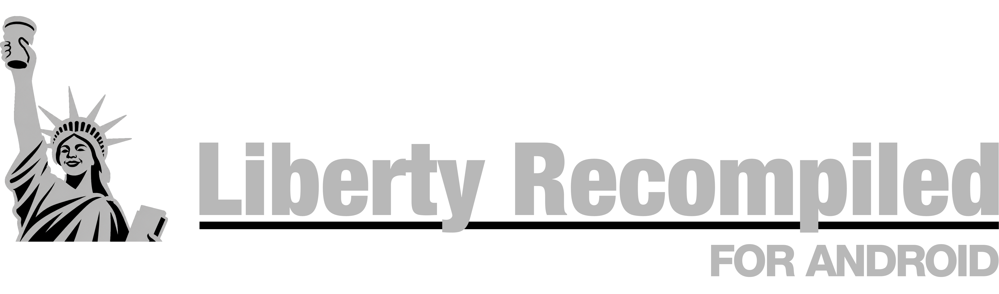
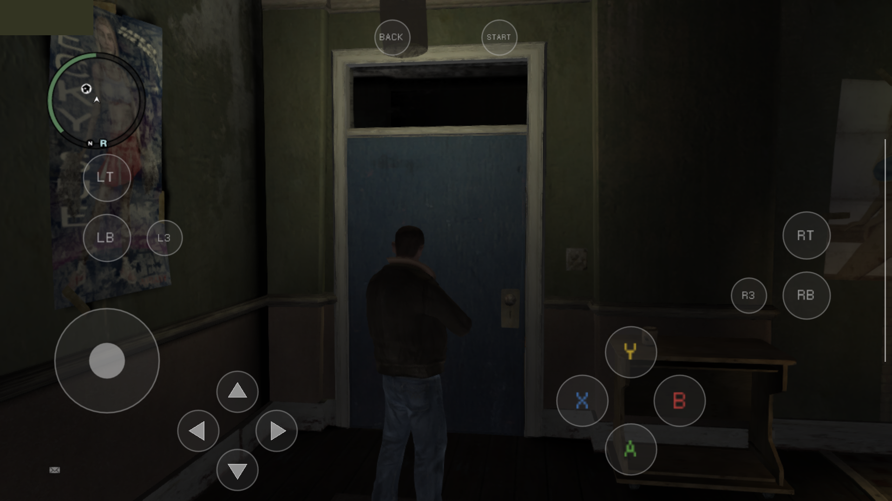
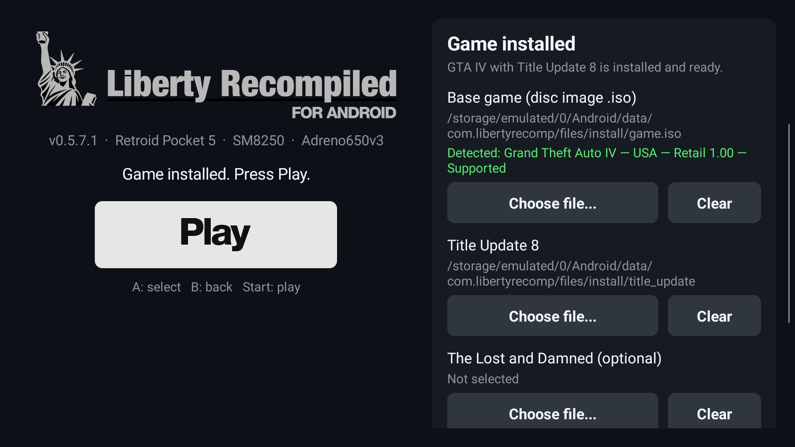

<p align="center">
    
</p>

# LibertyRecomp-MidRange-Edition 🎮📱

An optimized Android port of **Liberty Recompiled** (GTA IV Xbox 360 static recompilation), specially enhanced for **Mid-Range Android Devices (tested and stabilized on OPPO)**.

### ✨ Key Improvements in this Edition:
- **ARM Big-Core Thread Pinning:** Automatically binds heavy render, audio, and physics threads to CPU Big Cores, eliminating FPS dips and thermal throttling on mid-range SoCs.
- **3D Proximity Voice Chat:** Native 3D spatial voice chat engine (`gta4_proximity_engine`) for multiplayer and local voice interactions.
- **Custom GPU Driver Bridge:** Integrated Turnip / Adreno custom driver loader (`DriverBridge`) for smooth Vulkan 1.2+ rendering on Adreno chipsets.
- **Clean Worker Termination:** Prevents background zombie threads upon application shutdown.
- **Modular Android Architecture:** Modernized Kotlin & AGP build setup with external resource syncing and custom CLI arguments.

BTW, Any feedback is very appreciated, [Issues](https://github.com/vaduur/LibertyRecompAndroid/issues) are open, submit a ticket if you have any.


> [!CAUTION]
> This is an experimental, unofficial port of a project that is itself in early development.
> Expect crashes and rough edges. It has been developed and tested on **one device**, a
> Retroid Pocket 5 (Snapdragon 865 / Adreno 650).

> [!NOTE]
> New features land in **[pre-releases](https://github.com/vaduur/LibertyRecompAndroid/releases)**
> first, while they are being tested. The release marked *Latest* is the stable one. Pre-releases
> are listed above it and marked *Pre-release*. Feedback on them is welcome in
> [Issues](https://github.com/vaduur/LibertyRecompAndroid/issues).

**This project does not include any game assets.** You need your own legally obtained copy of the
Xbox 360 game and its title update. Nothing here helps you get them.

## Status

On the Retroid Pocket 5 with the default settings:

- The game installs, boots and plays: the intro, the early story missions, free roam and driving
  have been played. Saves persist across launches.
- The game renders at the console's native 720p with FXAA. The display scales the image to the panel.
- Frame rate is capped at 30 FPS with VSync. Most places hold a steady 30. The heaviest far views
  (bridges, the skyline at night) drop to about 25–29 FPS.
- Shadows, draw distance and the shadow map size match the console. Traffic and pedestrian density
  are reduced to 40% of the PC defaults to save CPU time.
- Audio works, including the radio, cutscenes and Bink videos.

Known problems:

- Occasional crashes to the home screen still happen. Save often.
- The in-game installer's **Select File / Select Folder** buttons do not work on Android. Install
  from the launcher (0.5.7+) or through the app's `install` folder instead (see
  [INSTALL.md](docs/android/INSTALL.md)).
- One deferred light-volume shader is skipped, because it hangs the GPU under Turnip. A few
  light volumes are missing as a result.
- The episodes (The Lost and Damned, The Ballad of Gay Tony) and online multiplayer have not been
  tested on Android.
- The on-screen gamepad is new (0.5.7.2) and has only been tried on the Retroid Pocket 5 so far
  (see [Controls](#controls)).

## Device requirements

| | Requirement |
|---|---|
| **GPU** | **Qualcomm Adreno 6xx or 7xx** (Snapdragon). Developed and tested on the Adreno 650. **Adreno 8xx: experimental since 0.5.7.5**, see below. |
| **SoC** | Snapdragon 865 class or faster recommended (SD 865/870/888, 8 Gen 1/2/3, 8s Gen 3, …). |
| **CPU** | arm64 with ARMv8.2-A (the build uses LSE atomics). ARMv8.0 chips such as the Snapdragon 835 crash on start. |
| **Android** | Android 10 (API 29) or newer, 64-bit. |
| **RAM** | 8 GB recommended. 6 GB is untested. |
| **Storage** | About 7 GB for the installed game, plus room for the disc image while installing (about 15 GB free in total). |
| **Controller** | An XInput (Xbox-layout) gamepad is strongly recommended, see [Controls](#controls). |

**Not supported:**

- **ARM Mali / Immortalis GPUs.** This covers most Exynos chips before the 2200, MediaTek
  Dimensity/Helio and Google Tensor.
- **Samsung Xclipse GPUs** (Exynos 2200 and newer).
- **PowerVR GPUs** and anything else that is not an Adreno.

Why only Adreno: the renderer needs Vulkan 1.2 and was tuned on Turnip. Turnip is Mesa's open-source
Vulkan driver, and it exists only for Adreno GPUs. The stock Qualcomm driver on older devices
(including the Adreno 650) exposes only Vulkan 1.1. On other GPUs the bundled driver cannot load,
and nobody has run the renderer on their vendor drivers.

**Adreno 8xx (Snapdragon 8 Elite and newer): experimental, since 0.5.7.5.** The game has been
started on an Adreno 840 (Samsung, Android 17). The bundled Turnip build does not support Adreno
8xx, so import a Turnip build for it on the launcher (**Import driver (.zip)**), such as the Gen8
Turnip builds made for emulators. This is how it was tested. Expect rough edges, and please report
how it runs in [Issues](https://github.com/vaduur/LibertyRecompAndroid/issues). Low-end Adreno
6xx parts (610/618/619) should start, but expect them to be far too slow.

Since 0.5.6.2, when the bundled Turnip cannot drive the GPU, the app falls back to the device's own
Vulkan driver if that driver offers Vulkan 1.2. This is untested on any GPU. If no usable driver
exists, the app shows a dialog with the reason instead of closing silently, and it writes
`Android/data/com.libertyrecomp/files/last_launch.txt` with the device, GPU and driver details.
Attach that file when you report a problem.

## Controls

**An XInput (Xbox-layout) gamepad is strongly recommended.** For example:

- an Xbox controller over Bluetooth or USB;
- any XInput-compatible pad;
- the built-in controls of a gaming handheld (Retroid, AYN Odin, AYANEO and similar) in Xbox
  mode.

The game is the Xbox 360 version, so its controls and button prompts follow the Xbox layout one to
one. Other controllers that Android recognizes (DualShock, DualSense, Switch Pro and so on) usually
work through SDL. Their buttons are mapped by position, though, and they have seen much less
testing.

**On-screen gamepad (0.5.7.2 and newer).** Without a controller, the game shows a translucent
Xbox 360 controller on the screen. It disappears as soon as a gamepad is connected, and comes back
when it is disconnected.



- **Left stick:** touch anywhere on the left half of the screen (outside the buttons). The stick
  centres where your thumb lands.
- **Right stick (camera):** touch anywhere on the right half of the screen. It works like a
  controller's right stick.
- **Buttons:** A/B/X/Y lower right, D-pad next to the left stick, LT/LB above the left stick, RT/RB
  on the right, L3/R3 next to the bumpers, Back/Start at the top. Several fingers work at once.
- **Menus** are driven with the same buttons, as on a controller.

Settings in `args.txt` (see [ADVANCED.md](docs/android/ADVANCED.md#other-useful-settings)):

- `--touch_controls=auto|on|off`. `auto` shows the overlay whenever no gamepad is connected, `on`
  always shows it, `off` never does.
- `--gta4_touch_layout=context` brings back upstream's context-sensitive touch layout instead of
  the gamepad.

## Game files required & Download reference

The port requires the original Xbox 360 files:
1. **The Xbox 360 GTA IV disc (.iso):** Must be the **USA (NTSC-U)** retail release.
   - Reference source: [Vimm's Lair - Grand Theft Auto IV (Xbox 360)](https://vimm.net/vault/78373)
   - Tested filename: `Grand Theft Auto IV (USA) (En,Fr,De,Es,It).iso` (~7.8 GB)
   - MD5: `f0a046aed1520a913b2125f0a69ee7d0`
2. **Title Update 8 (TU8):** Version **0.0.8.5** for the USA release (`TU_1A581VI_000000K000000.0000000000205` or raw `default.xexp`).

---

## 🚀 Guía de Instalación Rápida y Automatizada (Android / OPPO)

El instalador integrado detecta y extrae los componentes automáticamente:

### Paso 1: Instalar el APK
1. Descarga el APK desde la sección de **[Releases](https://github.com/emmahiguita/LibertyRecomp-MidRange-Edition/releases)**:
   - `LibertyRecompAndroid-v0.5.8.apk` (Recomendado para procesadores Snapdragon / Adreno).
   - `LibertyRecompAndroid-v0.5.8-mali-patched.apk` (Para procesadores Dimensity / GPUs Mali).
2. Abre el archivo en tu teléfono y concede permiso para instalar apps de fuentes desconocidas.

### Paso 2: Colocar los archivos del juego (2 Métodos a elegir)

* **Método A (Automático desde el Launcher - Recomendado):**
  1. Descarga tu copia `.iso` (por ejemplo desde [Vimm's Lair](https://vimm.net/vault/78373)) y el Title Update 8 en tu carpeta de **Descargas (Download)**.
  2. Abre la app **Liberty Recompiled**.
  3. En **Base game**, presiona **Choose file...** y selecciona tu archivo `.iso`. La app comprobará el archivo y mostrará una confirmación en verde:  
     `Detected: Grand Theft Auto IV — USA — Retail 1.00 — Supported`.
  4. En **Title Update 8**, selecciona el archivo de la actualización.
  5. Presiona **Install**. El sistema extraerá e instalará automáticamente el juego en 1–3 minutos.
  6. El botón **Play** se iluminará en blanco: ¡Tócalo y a jugar!
  *(Una vez instalado, puedes borrar el archivo `.iso` de 7.8 GB de tu teléfono para liberar espacio).*

* **Método B (Carpeta `install/` - 100% Automático sin selector):**
  1. Conecta el teléfono al PC o usa un gestor de archivos.
  2. Copia tu archivo `.iso` y el Title Update directamente en:
     ```text
     Android/data/com.libertyrecomp/files/install/
     ```
  3. Abre la app: el launcher detecta los archivos automáticamente, realiza la extracción e instala el juego sin pedirte buscar rutas.
   The tested files ([details](#game-files-required)):
   - disc: `Grand Theft Auto IV (USA) (En,Fr,De,Es,It).iso`, MD5 `f0a046aed1520a913b2125f0a69ee7d0`
   - TU8: `TU_1A581VI_000000K000000.0000000000205`, MD5 `f041b5f6721d7ee578560bac21668826`

   The file names do not matter, as long as the disc image ends in `.iso`.
3. Press **Install**, wait for it to finish, then press **Play**.



The full walkthrough, including the `install/` folder and older versions, is in
[INSTALL.md](docs/android/INSTALL.md).

## Documentation

| Document | Contents |
|---|---|
| [Installation and first launch](docs/android/INSTALL.md) | Installing the APK, copying the game files, the first-run installer, upgrading |
| [Advanced configuration](docs/android/ADVANCED.md) | `args.txt` settings, live tuning, driver selection, logs, performance presets |
| [What was done for Android](docs/android/PORTING.md) | Technical write-up of the port: build, platform layer, driver, renderer and stability work |
| [Building from source](docs/android/BUILDING.md) | Building the APK yourself |
| [Upstream README](README_UPSTREAM.md) | The original Liberty Recompiled README (desktop builds, mods, online) |

## Credits

- [Liberty Recompiled](https://github.com/OZORDI/LibertyRecomp) by OZORDI and contributors, and the
  [ReXGlue SDK](https://github.com/rexglue/rexglue-sdk) it is built on. Almost all of the hard work
  of recompiling GTA IV is theirs. This fork adds the Android platform layer and the Android
  performance work.
- [Mesa Turnip](https://docs.mesa3d.org/drivers/freedreno.html), the open-source Adreno Vulkan driver.
  The bundled build is StevenMXZ's Turnip 26.3.0-R6.
- [libadrenotools](https://github.com/bylaws/libadrenotools) by bylaws, which loads a custom driver
  into an app.
- The Vulkan driver proxy comes from [skate3-android](https://github.com/andrewnakas/skate3-android)
  and [skate3-pocket](https://github.com/AlanConstantino/skate3-pocket).
- [SDL3](https://github.com/libsdl-org/SDL) for the Android activity, input and audio.
- [nfsmw-nx](https://github.com/StevensND/nfsmw-nx) by StevensND, a ReXGlue port of Need for Speed:
  Most Wanted to the Nintendo Switch and a great reference for running a ReXGlue recompilation on
  weak hardware. Our direct-calls tool (`gta4-recomp/tools/direct_calls.py`) is adapted from their
  `llamadas_directas.py`. Their work on game busy-waits and thread placement led to this port's
  frame-wait hook and thread pinning experiments.

Grand Theft Auto IV is a trademark of Take-Two Interactive Software. This project is not affiliated
with or endorsed by Rockstar Games or Take-Two Interactive.
