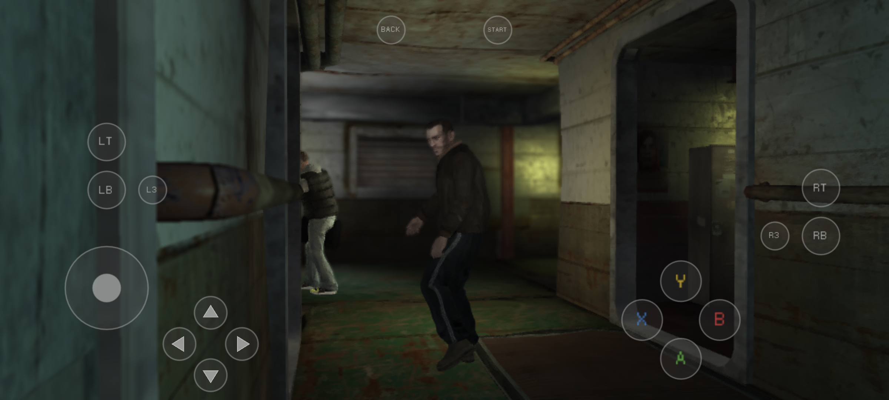
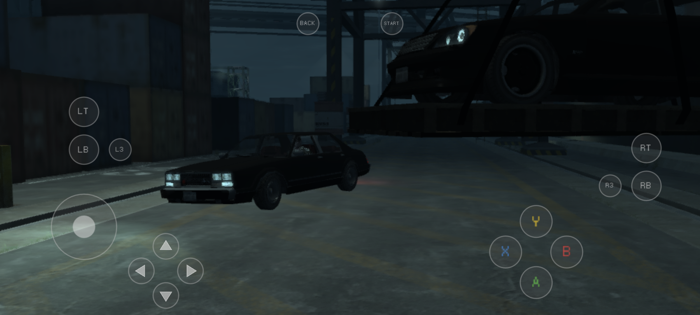

<p align="center">
    
</p>

# LibertyRecomp-MidRange-Edition 🎮📱

[](https://github.com/emmahiguita/LibertyRecomp-MidRange-Edition/releases)
[](https://github.com/emmahiguita/LibertyRecomp-MidRange-Edition)
[](https://github.com/emmahiguita/LibertyRecomp-MidRange-Edition)
[](https://github.com/emmahiguita)

Port nativo y optimizado de **Liberty Recompiled** (recompilación estática de GTA IV Xbox 360) para **dispositivos Android de gama media**, con soporte pionero para GPUs **ARM Mali** y procesadores **MediaTek Dimensity / Qualcomm Snapdragon**. Desarrollado y verificado en **OPPO A79 5G**.

---

## 📸 Demostración en Vivo (OPPO A79 5G - GPU Mali-G57 MC2)

El juego corre en tiempo real con iluminación dinámica, físicas activas y controles táctiles en pantalla:

| Niko Bellic en el Platypus (Render 3D) | Llegada al Muelle de Liberty City |
|:---:|:---:|
|  |  |

---

## ✨ Novedades y Optimizaciones de esta Edición

* **🛡️ Compatibilidad Nativa con GPUs Mali (Dimensity & Exynos con ARMv8.2-A):**
  - **Parcheador SPIR-V en tiempo real:** Intercepta la creación de shaders (`vkCreateShaderModule`) traduciendo `OpCapability ClipDistance` y reasignando registros a `Location 15` para evitar cierres de `libGLES_mali.so`.
  - **Decodificador en memoria de texturas BCn (BC1–BC7):** Emula formatos de consola no soportados por el hardware de Mali sin fuga de memoria ni caídas de VRAM.
* **⚡ Fijación de Hilos a Big-Cores (CPU Thread Pinning):**
  - Vincula automáticamente los hilos pesados de renderizado, audio y físicas a los núcleos de alto rendimiento (Cortex-A76), eliminando tirones y sobrecalentamiento en SoCs de gama media.
* **🔊 Audio Estable sin Cortes (Normal Mixer AAudio):**
  - Buffer de 2048 muestras configurado para garantizar 0 underruns de audio en situaciones de alta carga.
* **🎙️ Motor de Voz Espacial 3D (`gta4_proximity_engine`):**
  - Soporte nativo para chat de proximidad 3D en partidas locales y multijugador.
* **🎮 Selector y Puente de Drivers (Turnip & System Driver):**
  - Carga el driver del sistema de forma segura en chipsets MediaTek/Mali o activa Turnip 26.3.0 en GPUs Adreno 6xx/7xx.
* **📱 UI y Lanzador Personalizado:**
  - Enlaces oficiales integrados a este repositorio, panel de diagnóstico detallado y selector de perfiles de rendimiento integrados.

---

## 📱 Compatibilidad y Requisitos de Dispositivo

| Componente | Requisito Mínimo | Dispositivos Probados |
|:---|:---|:---|
| **GPU** | **ARM Mali-G57 o superior** / **Qualcomm Adreno 6xx/7xx** con Vulkan 1.2+ | **OPPO A79 5G** (Mali-G57 MC2) ✅<br>Retroid Pocket 5 (Adreno 650) ✅ |
| **SoC** | MediaTek Dimensity 6020 / Snapdragon 7xx/8xx o superior | MT6833, SD865, SD870, SD8 Gen 2 |
| **Arquitectura CPU** | **arm64 con ARMv8.2-A** (obligatorio por instrucciones atómicas LSE nativas) | *Nota: Chips ARMv8.0 antiguos (Exynos 7904, SD835) no soportan instrucciones atómicas nativas.* |
| **Android** | Android 10 (API 29) o superior (Probado en Android 15 / API 35) | Android 11 a 15 |
| **Memoria RAM** | 6 GB mínimo (8 GB recomendado) | 8 GB en OPPO A79 5G |
| **Almacenamiento** | ~7 GB para el juego instalado (más ~8 GB temporales para la instalación inicial) | Almacenamiento interno |

---

## 🎮 Controles y Jugabilidad

* **Controles Táctiles en Pantalla:** Configuración completa de botones Xbox 360 (Stick izquierdo de movimiento, Stick derecho de cámara analógica, cruceta D-pad, gatillos LT/RT, bumpers LB/RB, A/B/X/Y y botones Start/Back).
* **Gamepads Físicos:** Reconocimiento instantáneo vía Bluetooth o USB (Mandos Xbox One/Series, DualShock 4, DualSense o mandos telescópicos para móviles).

---

## 💿 Archivos del Juego Necesarios

1. **Disco Original Xbox 360 GTA IV (.iso):** Versión retail **USA (NTSC-U)**.
   - Fuente de referencia: [Vimm's Lair - Grand Theft Auto IV (Xbox 360)](https://vimm.net/vault/78373)
   - Archivo probado: `Grand Theft Auto IV (USA) (En,Fr,De,Es,It).iso` (~7.8 GB)
   - MD5: `f0a046aed1520a913b2125f0a69ee7d0`
2. **Title Update 8 (TU8):** Versión **0.0.8.5** para la edición USA (`TU_1A581VI_000000K000000.0000000000205` o archivo `default.xexp`). Se encuentra incluido en nuestros [Releases](https://github.com/emmahiguita/LibertyRecomp-MidRange-Edition/releases).

---

## 🚀 Guía de Instalación Rápida (1 Minuto)

### Paso 1: Instalar el APK
Descarga la versión adecuada para tu dispositivo desde nuestros **[Releases Oficiales](https://github.com/emmahiguita/LibertyRecomp-MidRange-Edition/releases)**:
* **`LibertyRecompAndroid-v0.5.9-mali-fixed.apk`**: Para procesadores **MediaTek / GPUs Mali** (OPPO, Xiaomi, Realme, etc.).
* **`LibertyRecompAndroid-v0.5.8.apk`**: Para procesadores **Snapdragon / GPUs Adreno** (con soporte Turnip).

### Paso 2: Instalación de los Datos del Juego (Elige un método)

* **Método A (Desde el Menú del Juego - Recomendado):**
  1. Guarda tu archivo `.iso` y la actualización `TU_...` en la carpeta **Descargas** de tu teléfono.
  2. Abre la app **Liberty Recompiled**.
  3. En **Base game**, toca **Choose file...** y selecciona tu archivo `.iso`. Verás una confirmación en verde:  
     `Detected: Grand Theft Auto IV — USA — Retail 1.00 — Supported`.
  4. En **Title Update 8**, selecciona el archivo de la actualización.
  5. Presiona **Install**. El proceso tardará unos minutos en extraer y configurar el juego.
  6. Presiona **Play**: ¡a disfrutar de Liberty City! *(Una vez instalado puedes borrar la ISO de 7.8 GB para recuperar espacio).*

* **Método B (100% Automático por Carpeta):**
  1. Conecta tu teléfono al PC o usa un administrador de archivos.
  2. Coloca el archivo `.iso` y la actualización directamente en:
     ```text
     Android/data/com.libertyrecomp/files/install/
     ```
  3. Abre la app: el lanzador detectará ambos archivos automáticamente, realizará la instalación y encenderá el botón **Play**.

---

## 📚 Documentación Técnica

| Documento | Descripción |
|:---|:---|
| [Guía de Instalación Detallada](docs/android/INSTALL.md) | Pasos exhaustivos de instalación y resolución de problemas. |
| [Configuración Avanzada (`args.txt`)](docs/android/ADVANCED.md) | Parámetros del motor, resolución interna, variables de entorno y perfiles. |
| [Detalles de la Adaptación a Android](docs/android/PORTING.md) | Explicación del port de arquitectura, capa de plataforma y drivers. |
| [Compilación desde el Código Fuente](docs/android/BUILDING.md) | Instrucciones para compilar el APK y librerías nativas con Gradle y NDK. |

---

## 👤 Autor y Contacto
* **Desarrollador / Mantenedor:** Emmanuel Higuita ([@emmahiguita](https://github.com/emmahiguita))
* **Repositorio Oficial:** [github.com/emmahiguita/LibertyRecomp-MidRange-Edition](https://github.com/emmahiguita/LibertyRecomp-MidRange-Edition)
* **Reporte de Fallos e Ideas:** [GitHub Issues](https://github.com/emmahiguita/LibertyRecomp-MidRange-Edition/issues)

---

## ⚖️ Reconocimientos y Licencias
* [Liberty Recompiled](https://github.com/OZORDI/LibertyRecomp) por OZORDI y colaboradores, y el framework [ReXGlue SDK](https://github.com/rexglue/rexglue-sdk).
* [Mesa Turnip](https://docs.mesa3d.org/drivers/freedreno.html), driver Vulkan libre para GPUs Qualcomm Adreno.
* [libadrenotools](https://github.com/bylaws/libadrenotools) por bylaws.
* [SDL3](https://github.com/libsdl-org/SDL) para la gestión de ventanas, entradas táctiles y audio en Android.
* *Grand Theft Auto IV es una marca registrada de Take-Two Interactive Software y Rockstar Games. Este proyecto es una recompilación estática comunitaria sin fines de lucro, independiente y no oficial.*
